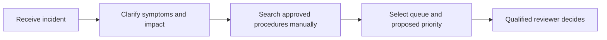
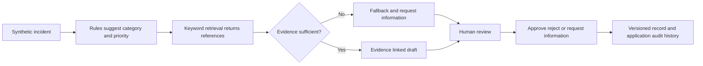

# Maintenance analyst workflow

All incidents and procedures are fictional. The baseline is a workflow hypothesis, not an observed customer process.

## As is hypothesis

## Prototype workflow

Safety-related incidents bypass model drafting. No machine action is executed. Record versions prevent stale updates; final approvals/rejections cannot be silently replaced.

## Proposed pilot

Agree scope, approved sources, historical cases and quality thresholds with stakeholders. Measure manual versus assisted lookup time and correct-source selection on comparable tasks. Track corrections, fallback, escalation, adoption and operating cost. No human productivity benchmark or customer outcome has been measured.
